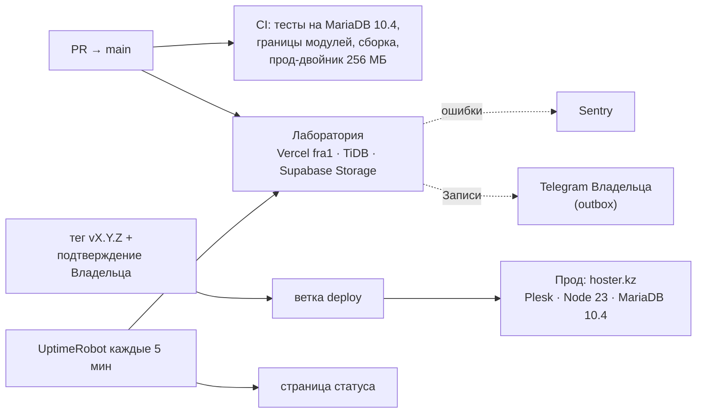

# Athletic's Gym — сайт реального клуба и платформа для любого клуба

> Лендинг проекта, обновлён 12 ноября 2026. Термины — [GLOSSARY.md](./GLOSSARY.md), решения — [docs/adr](./docs/adr), план — [docs/engineering-roadmap.md](./docs/engineering-roadmap.md).

**Реальный клиент.** Athletic's Gym в Кызылорде: два Зала (общий и женский) и сайт на русском и казахском. В админке Владелец с телефона ведёт Тарифы, Тренеров, Фото, Отзывы и тексты. Боевой сайт **https://athleticsgym.kz** работает на хостинге в Казахстане (hoster.kz, 256 МБ памяти) и заморожен на релизе **`v1.0.0`**. Новые версии попадают к клиенту только по решению Владельца.

**Лаборатория.** Тот же код развивается в платформу для любого Клуба: **https://athletics-gym-lab.vercel.app**.
- **Данные.** Бренд, тексты и Тарифы — от Athletic's Gym. Тренеры, Клиенты, Записи, Отзывы и Обращения — вымышленные, личных данных нет.
- **Выкатка.** `main` выкатывается автоматически, каждый PR получает превью со своей базой.
- **Статус и SLO** — **https://korolmo.github.io/athletics-gym/**.

## Посмотреть самому

| Что | Где | Как |
|---|---|---|
| Сайт | https://athletics-gym-lab.vercel.app/ru (и `/kk`) | — |
| Личный кабинет Клиента: запись к Тренеру | https://athletics-gym-lab.vercel.app/ru/cabinet | Номер `+7 700 000 00 01` … `09` — код входа показывается на экране (демо-канал, только тестовые номера) |
| Админка Владельца | https://athletics-gym-lab.vercel.app/admin | Кнопка «Войти как гость» — включается после закрытия этапа 1 (~17 ноября). Правки видны всем и сбрасываются в 04:00 по времени Клуба ([runbook](./docs/runbooks/demo-admin.md)) |

## Цифры

| | |
|---|---|
| Память собранного сервера под нагрузкой (прод-двойник, лимит хостинга 256 МБ), медиана 8 прогонов CI | пик **~200 МБ**, после запуска **~115 МБ** (Next 16) |
| Задержка страниц и API на прод-двойнике, p50 / p95 | **~50 / ~380 мс** |
| Пакет для хостинга (без `node_modules` на сервере) | **106 МБ**; с Prisma 7 — 39 МБ ([PR #104](https://github.com/korolmo/athletics-gym/pull/104), после этапа П1) |
| Холодный старт: Vercel (первый запрос к свежему деплою) / прод-двойник (до первого `/ru`) | **~1,1 с / ~2 с** |
| SLO Лаборатории | **99,5 %** проверок страниц `/ru` и `/kk` за 30 дней — ответ 200 быстрее 1 с; проверки UptimeRobot каждые 5 минут (ADR 0014) |
| Скорость главной на боевом сайте (Lighthouse, телефон) | LCP 1,8–2,0 с, CLS 0, Accessibility 100 |
| Название и город Клуба в коде (вне начальных значений) | **0** строк — было 42 до этапа П1 (тест `brand-mentions.test.ts`) |
| Тесты | **~1000** на Vitest: домен, сервисы, маршруты; плюс тесты на MariaDB 10.4 в CI, включая гонку 50 параллельных Записей |
| Решения | **21 ADR** · история — 103 PR |

Методика и цифры «до/после» — в журнале этапов ниже.

## Архитектура



Подробно — C4 контейнеров: [docs/architecture/containers.md](./docs/architecture/containers.md).

- **Один Next.js-проект** на сайт, кабинет и админку: Next 16 (App Router, standalone, Turbopack), TypeScript, Tailwind 4, Prisma 6 (переход на Prisma 7 готов).
- **Модули по сущностям** (ADR 0015): `src/modules/<имя>` со слоями `domain` → `validation` → `service`. Снаружи модуль доступен только через `index.ts` и `client.ts`, чужие таблицы — только через модуль-хозяина. Границы проверяет dependency-cruiser в CI.
- **Две среды, один код.** Vercel (serverless) и виртуальный хостинг без SSH и Docker. Совместимость с продом проверяет прод-двойник в CI: те же 256 МБ и 1 CPU, MariaDB 10.4, запуск через `start.cjs` с миграциями.
- **Гарантии у базы** (ADR 0017):
  - двойную Запись на одно Окно запрещает уникальный индекс;
  - повтор формы распознаётся по ключу повтора;
  - лимит Записей держит блокировка строки Клиента.
- **Уведомления через transactional outbox.** Событие пишется в одной транзакции с Записью, у отправки есть повторы и dead-letter. Отправка идёт попутно, после ответов: на хостинге нет планировщика, а cron GitHub опаздывает на часы.
- **Клуб — это данные** (ADR 0018). Название, город, логотип, цвет акцента с правилом контраста WCAG и часовой пояс берутся из базы. Второй Клуб — этап П2 (ADR 0020–0021).
- **Наблюдаемость.** JSON-логи с `request_id` и строкой доступа, `/api/health/live|ready`, ошибки в Sentry, проверки UptimeRobot с бюджетом ошибок, холодный старт по заголовку `X-Cold-Start`. Всё это только в Лаборатории: прод снаружи никто не опрашивает.

## Ключевые решения

| ADR | Решение |
|---|---|
| [0004](./docs/adr/0004-hosting-plesk-kz.md) | Переезд с Vercel + Supabase на хостинг в РК: MariaDB 10.4, Фото на диске, выкатка через ветку `deploy` без SSH |
| [0005](./docs/adr/0005-production-constraints-as-design-frame.md) | Ограничения прода (256 МБ, без постоянного процесса) — рамка проектирования; прод-двойник в CI |
| [0006](./docs/adr/0006-trunk-based-staging-promotion.md) | Trunk-based: `main` → Лаборатория непрерывно, прод — релизный тег вручную |
| [0007](./docs/adr/0007-platform-demo-club.md) | Платформа для любого Клуба; витрина — реальный клиент без личных данных |
| [0010](./docs/adr/0010-sentry-minimal-sender.md) | Свой отправщик в Sentry вместо SDK (+14…20 МБ на прод-двойнике) |
| [0012](./docs/adr/0012-ephemeral-preview-databases.md) | Своя одноразовая база у каждого превью PR |
| [0013](./docs/adr/0013-error-pages.md) | Страницы ошибок 404/500/503: готовый HTML без базы, двуязычная 404 одна на все адреса |
| [0015](./docs/adr/0015-modules-by-entity.md) | Модули по сущностям с проверяемыми границами |
| [0016](./docs/adr/0016-client-cabinet-personal-data.md) | Кабинет Клиента: вход по телефону и коду, минимум персональных данных |
| [0017](./docs/adr/0017-bookings-db-uniqueness-outbox.md) | Записи: гарантии уникальности у базы, уведомления через outbox |
| [0018](./docs/adr/0018-club-brand-as-data.md) | Клуб и бренд — данные, а не код |
| [0019](./docs/adr/0019-guest-demo-admin.md) | Гостевая демо-админка с суточным сбросом без планировщика |
| [0020](./docs/adr/0020-club-isolation-club-id.md) · [0021](./docs/adr/0021-club-by-host.md) | Несколько Клубов: `clubId` и клиент базы Клуба, Клуб по адресу запроса (предложено) |

## Что умеет

- **Сайт** `/ru`, `/kk`:
  - разделы: первый экран, бегущая строка, о зале, Направления, Женский зал, цены по Залам («от» — минимум по Категории тарифа), Галерея, Тренеры с персональными Тарифами, Отзывы, контакты с картой по нажатию;
  - целевое действие — Обращение (WhatsApp, телефон, Instagram); счётчик Обращений без персональных данных.
- **Личный кабинет Клиента** (только Лаборатория):
  - вход по телефону и одноразовому коду;
  - запись к Тренеру в свободное Окно по его часам работы;
  - «Мои Записи», отмена в установленный срок, Согласие на обработку данных.
- **Админка** `/admin` (Владелец):
  - Записи по дням и Тренерам, недоставленные уведомления со сводкой доставки;
  - Тарифы, Тренеры с часами работы и исключениями;
  - Настройки сайта и показ Блоков, форма «Клуб» (название, город, цвет, логотип);
  - Фото (сжатие в браузере, копии 400 и 800 px), Отзывы (модерация и ручные), Направления;
  - сводка Обращений, Реквизиты, аккаунт и «выйти на всех устройствах».
  - В Лаборатории — гостевой вход: всё, кроме Фото, аккаунта и удалений.
- **Качество:**
  - WCAG AA; движение только на CSS и IntersectionObserver;
  - кэш главной со сбросом при каждом сохранении в админке;
  - SEO с hreflang и JSON-LD;
  - Политика конфиденциальности и Пользовательское соглашение на двух языках;
  - CSP и заголовки безопасности.

## Журнал этапов

| Этап | Суть | Статус |
|---|---|---|
| [0 — Фундамент](./docs/stages/stage-0-foundation.md) | Заморозка прода на теге, Лаборатория, прод-двойник, логи, health, SLO | закрыт 25 октября |
| [6 — Модули](./docs/stages/stage-6-modules.md) | Модули по сущностям, dependency-cruiser в CI, C4 | код готов, итоги — 14 ноября |
| [1 — Кабинет и запись](./docs/stages/stage-1-cabinet.md) | Вход Клиента, Записи без двойного бронирования, outbox, новая админка | код готов, неделя в Лаборатории до ~17 ноября |
| [П1 — Бренд Клуба](./docs/stages/stage-p1-brand.md) | Бренд, тема и тексты — данные; гостевая демо-админка со сбросом | код готов, неделя после этапа 1 |
| [П2 — Несколько Клубов](./docs/stages/stage-p2-tenancy.md) | Изоляция данных, Клуб по адресу, второй вымышленный Клуб | план согласован 11 ноября |

## Запуск (Windows, PowerShell)

Нужны Node.js 22+ и Docker Desktop.

```powershell
npm run db:up            # MariaDB 10.4 в Docker (порт 3307)
copy .env.example .env   # задать ADMIN_LOGIN, ADMIN_PASSWORD, AUTH_SECRET
npm install
npm run db:migrate
npm run seed             # Залы, Тарифы, Тренеры из прайса Владельца; на APP_ENV=production откажется
npm run dev              # http://localhost:3000, кабинет — /ru/cabinet, админка — /admin
```

| Команда | Что делает |
|---|---|
| `npm run lint` · `npm run typecheck` · `npm run deps:check` · `npm test` · `npm run build` | Проверки перед коммитом (CI делает то же) |
| `npm run build` → `node scripts/standalone/assemble.mjs` → `npm run twin:measure` | Прод-двойник: пакет для хостинга в Docker с лимитами hoster.kz; RSS, p50/p95, холодный старт |
| `node scripts/twin/history.mjs` | Медианы прод-двойника по прогонам CI на `main` — для замеров «до/после» |
| `npm run seed:lab` | Данные Лаборатории (TiDB, из `.env.lab`) |

## Документы

- **Выкатка:**
  - [docs/deploy.md](./docs/deploy.md) — базы, миграции, Лаборатория;
  - [docs/runbooks/release.md](./docs/runbooks/release.md) — релиз и hotfix прода;
  - [docs/hosting-plesk.md](./docs/hosting-plesk.md) — Plesk, перенос, откат.
- **Эксплуатация:**
  - [docs/runbooks/observability.md](./docs/runbooks/observability.md) — SLO, логи, алерты;
  - [docs/runbooks/notifications.md](./docs/runbooks/notifications.md) — уведомления о Записях;
  - [docs/runbooks/demo-admin.md](./docs/runbooks/demo-admin.md) — демо-админка и суточный сброс.
- **Клиент:**
  - [docs/admin-plan.md](./docs/admin-plan.md) — этапы админки 0–9, все в `v1.0.0`;
  - `docs/owner/` — расшифровка прайса и карточек Тренеров. Исходные плакаты с личными контактами в репозиторий не попадают.

Секреты хранятся только в `.env`, `.env.lab` (локально), переменных Vercel и Plesk и секретах GitHub. Файлы `.env*` в git и в ветку `deploy` не попадают.
