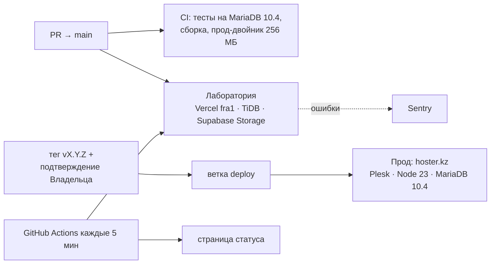

# Athletic's Gym — сайт реального клуба и платформа для любого клуба

> Черновик лендинга (этап 0, 17 октября 2026). Термины — [GLOSSARY.md](./GLOSSARY.md), решения — [docs/adr](./docs/adr), план — [docs/engineering-roadmap.md](./docs/engineering-roadmap.md).

**Реальный клиент.** Athletic's Gym, Кызылорда: два Зала (общий и женский), сайт на русском и казахском и админка, в которой Владелец с телефона ведёт Тарифы, Тренеров, Фото, Отзывы и тексты. Боевой сайт **https://athleticsgym.kz** работает на хостинге в Казахстане (hoster.kz, 256 МБ памяти) и заморожен на релизе **`v1.0.0`**. Новые версии попадают к клиенту только по решению Владельца.

**Лаборатория.** Тот же код развивается в платформу для любого Клуба: **https://athletics-gym-lab.vercel.app**. Бренд, тексты и Тарифы — Athletic's Gym, Тренеры, Отзывы и Обращения — вымышленные, личных данных нет. `main` выкатывается туда автоматически, каждый PR получает превью. Статус и SLO — **https://korolmo.github.io/athletics-gym/**.

## Цифры

| | |
|---|---|
| Память собранного сервера под нагрузкой (прод-двойник, лимит хостинга 256 МБ) | пик **~200 МБ**, после запуска ~135 МБ |
| Задержка страниц и API на прод-двойнике, p50 / p95 | **~50 / ~420 мс** |
| Холодный старт: Vercel (первый запрос к свежему деплою) / прод-двойник (до первого `/ru`) | **~1,1 с / ~2 с** |
| SLO Лаборатории | **99,5 %** проверок за 30 дней — ответ 200 быстрее 1 с |
| Скорость главной на боевом сайте (Lighthouse, телефон) | LCP 1,8–2,0 с, CLS 0, Accessibility 100 |
| Тесты | **732** (Vitest: домен, сервисы, маршруты; интеграционные — на MariaDB 10.4) |
| Решения | **11 ADR** · история — 44 PR |

Методика и цифры «до/после» — [docs/stages/stage-0-foundation.md](./docs/stages/stage-0-foundation.md).

## Архитектура



Подробно — C4 контейнеров: [docs/architecture/containers.md](./docs/architecture/containers.md).

- **Один Next.js-проект** на сайт, админку и будущий кабинет: Next 15 (App Router, standalone), TypeScript, Tailwind 4, Prisma 6.
- **Слои:** `lib/domain` (чистые правила) → `lib/validation` (zod) → `lib/services` (Prisma, проверка сессии) → тонкие server actions.
- **Две среды, один код.** Vercel (serverless) и виртуальный хостинг без SSH и Docker. Совместимость с продом проверяет прод-двойник в CI.
- **Наблюдаемость.** JSON-логи с `request_id` и строкой доступа, `/api/health/live|ready`, ошибки в Sentry, синтетика с бюджетом ошибок и burn rate. Всё только в Лаборатории: прод снаружи никто не опрашивает.

## Ключевые решения

| ADR | Решение |
|---|---|
| [0004](./docs/adr/0004-hosting-plesk-kz.md) | Переезд с Vercel + Supabase на хостинг в РК: MariaDB 10.4, Фото на диске, выкатка через ветку `deploy` без SSH |
| [0005](./docs/adr/0005-production-constraints-as-design-frame.md) | Ограничения прода (256 МБ, без постоянного процесса) — рамка проектирования; прод-двойник в CI |
| [0006](./docs/adr/0006-trunk-based-staging-promotion.md) | Trunk-based: `main` → Лаборатория непрерывно, прод — релизный тег вручную |
| [0007](./docs/adr/0007-platform-demo-club.md) | Платформа для любого Клуба; витрина — реальный клиент без личных данных |
| [0008](./docs/adr/0008-lab-vercel-cli-deploys.md) | Два проекта Vercel в одном репозитории без риска для редиректа прода |
| [0009](./docs/adr/0009-json-logs-access-line.md) | Строка доступа в обеих средах: перехват `http.ServerResponse` |
| [0010](./docs/adr/0010-sentry-minimal-sender.md) | Свой отправщик в Sentry вместо SDK (+14…20 МБ на прод-двойнике) |
| [0011](./docs/adr/0011-cold-start-separate-sli.md) | Холодный старт — отдельный SLI, без прогрева |

## Что умеет сайт

- **Сайт** `/ru`, `/kk`: первый экран, бегущая строка, о зале, Направления, Женский зал, цены по Залам («от» — минимум по Категории тарифа), Галерея, Тренеры с персональными Тарифами, Отзывы, контакты с картой по нажатию. Целевое действие — Обращение (WhatsApp, телефон, Instagram), счётчик без персональных данных.
- **Админка** `/admin` (только Владелец): Тарифы, Тренеры, Настройки сайта и показ Блоков, Фото (сжатие в браузере, копии 400/800 px), Отзывы (модерация, ручные), Направления, сводка Обращений, Реквизиты, аккаунт и «выйти на всех устройствах».
- **Качество:** WCAG AA, движение только на CSS и IntersectionObserver, кэш главной со сбросом при каждом сохранении в админке, SEO с hreflang и JSON-LD, Политика конфиденциальности и Пользовательское соглашение на двух языках, CSP и заголовки безопасности.

## Запуск (Windows, PowerShell)

Нужны Node.js 22+ и Docker Desktop.

```powershell
npm run db:up            # MariaDB 10.4 в Docker (порт 3307)
copy .env.example .env   # задать ADMIN_LOGIN, ADMIN_PASSWORD, AUTH_SECRET
npm install
npm run db:migrate
npm run seed             # Залы, Тарифы, Тренеры из прайса Владельца; на APP_ENV=production откажется
npm run dev              # http://localhost:3000, админка — /admin
```

| Команда | Что делает |
|---|---|
| `npm run lint` · `npm run typecheck` · `npm test` · `npm run build` | Проверки перед коммитом (CI делает то же) |
| `npm run build` → `node scripts/standalone/assemble.mjs` → `npm run twin:measure` | Прод-двойник: пакет для хостинга в Docker с лимитами hoster.kz; RSS, p50/p95, холодный старт |
| `npm run seed:lab` | Данные Лаборатории (TiDB, из `.env.lab`) |

## Документы

- **Выкатка:** [docs/deploy.md](./docs/deploy.md) (базы, миграции, Лаборатория) · [docs/runbooks/release.md](./docs/runbooks/release.md) (релиз и hotfix прода) · [docs/hosting-plesk.md](./docs/hosting-plesk.md) (Plesk, перенос, откат).
- **Эксплуатация:** [docs/runbooks/observability.md](./docs/runbooks/observability.md) — SLO, логи, алерты, что делать при сбое.
- **Клиент:** [docs/admin-plan.md](./docs/admin-plan.md) — этапы админки 0–9 (все в `v1.0.0`); `docs/owner/` — расшифровка прайса и карточек Тренеров. Исходные плакаты с личными контактами в репозиторий не попадают.

Секреты — только в `.env`, `.env.lab` (локально), переменных Vercel и Plesk. Файлы `.env*` в git и в ветку `deploy` не попадают.
