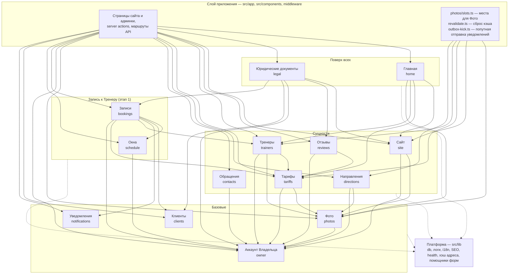

# C4: компоненты приложения (уровень 3)

Контейнер «Приложение Next.js» из [containers.md](./containers.md), разрезанный на модули на этапе 6 (ADR 0015).
Связи сняты с кода 7 ноября 2026 (dependency-cruiser, PR 12), модули этапа 1 (кабинет Клиента, ADR 0016–0017) дорисованы 10 ноября — та же картина в сводке каждого прогона CI (job «Dependency boundaries», артефакт `deps-graph`). Если рисунок и граф CI разошлись, прав граф: поправьте рисунок в том же PR.

## Как читать

- **Стрелка — «импортирует через `index.ts` / `client.ts`».** Внутрь чужого модуля не ходит никто (`module-via-index-*`).
- **Вверх стрелок нет.** Платформа не импортирует модули (`lib-no-modules`); Главную и Юридические документы не импортирует ни один модуль (`top-modules`); Фото знает только Аккаунт Владельца (`photos-knows-no-one`). Клиенты и Уведомления не знают никого (`clients-knows-no-one`, `notifications-knows-no-one`), Окна — только Аккаунт Владельца (`schedule-knows-only-owner`), Записи не импортирует ни одна сущность (`bookings-on-top-of-entities`).
- **Обратные потребности — через слой приложения.** Фото не знает владельцев мест — места собирает `slots.ts`; Тарифам нужен Зал Тренера — его передаёт действие админки; Отзывам нужна дата редакции Политики — её передаёт действие сайта; `health` получает хранилище Фото и проверку Владельца от маршрутов; Уведомления получают событие запросом Записей в их транзакции (`enqueue`), а отправку запускает слой приложения (`outbox-kick.ts`); Окна связаны с Тренером только внешним ключом с каскадом.
- **Таблицы — только у хозяина.** У каждого модуля `tables.test.ts`: Главная и Юридические документы своих таблиц не имеют, Фото — только Галерея. Запись в чужую таблицу в общей транзакции — запросом модуля-хозяина (`moveTrainerTariffs`).

| Модуль | Таблицы | Входы |
|---|---|---|
| owner | `owner`, `loginAttempt` | `index.ts`, `client.ts` (middleware, форма пароля) |
| photos | `galleryPhoto` | `index.ts`, `client.ts` |
| tariffs | `hall`, `tariff` | `index.ts`, `client.ts` |
| trainers | `trainer` | `index.ts`, `client.ts` |
| directions | `direction` | `index.ts`, `client.ts` |
| reviews | `review`, `reviewSubmission` | `index.ts`, `client.ts` |
| contacts | `contactClick` | `index.ts`, `client.ts` |
| site | `siteSettings`, `aboutCard` | `index.ts`, `client.ts` |
| home | — | `index.ts` |
| legal | — | `index.ts`, `client.ts` (адреса и даты редакций) |
| clients | `client`, `clientLoginCode` | `index.ts`, `client.ts` (middleware: cookie сессии Клиента) |
| schedule | `trainerSchedule`, `trainerWorkHours`, `trainerTimeOff` | `index.ts`, `client.ts` |
| bookings | `booking` | `index.ts`, `client.ts` (лимиты и срок отмены — для текстов) |
| notifications | `outboxEvent` | `index.ts`, `client.ts` (правила повторов и подписи событий) |
