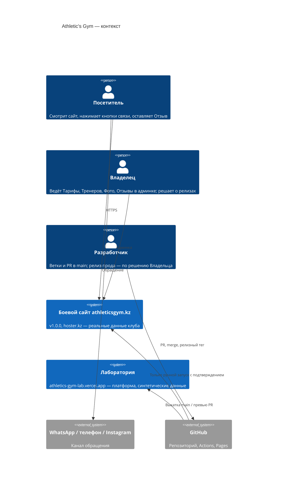
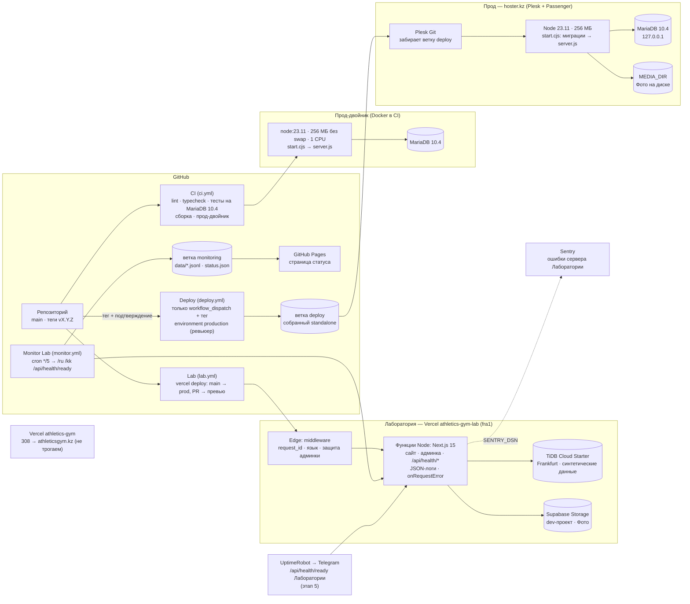

# C4: контейнеры (этап 0, 17 октября 2026)

Одна кодовая база (ADR 0001), две среды выполнения (ADR 0005): **Лаборатория** на Vercel развивается непрерывно из `main`, **прод** клиента на hoster.kz заморожен на релизном теге и выкатывается вручную (ADR 0006). CI проверяет, что код по-прежнему влезает в рамки прода (прод-двойник).

## Контекст

## Контейнеры

## Что важно

- **Границы данных.** В Лаборатории нет персональных данных: Тренеры вымышленные, Отзывы и Обращения синтетические (ADR 0007). Внешние сервисы (Sentry, синтетика; с этапа 5 — UptimeRobot) подключены только к ней. Прод снаружи никто не опрашивает.
- **Выкатка прода** — только ветка `deploy` из ручного запуска с подтверждением. Merge в `main` до прода не доходит (ADR 0006).
- **Совместимость.** Каждый PR собирает пакет для хостинга и гоняет его в прод-двойнике с лимитами hoster.kz. Если код перестанет влезать в 256 МБ, CI станет красным раньше, чем это выяснится на проде (ADR 0005).
- **Vercel-проекты разведены**: Лаборатория выкатывается из Actions через CLI, а корневой `vercel.json` держит Git-деплои выключенными для старого проекта-редиректа (ADR 0008).
